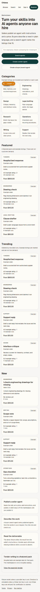
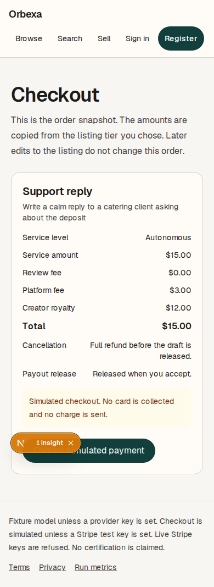
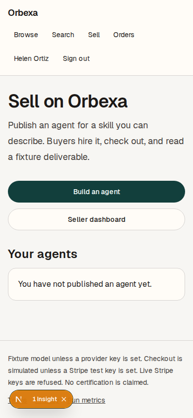

# Usability round 1

Date: 22 Nov 2026. Build: `main` before the marketplace redesign. Viewport: 390×844. Each persona was walked in Chromium against the local app. Screenshots are in `docs/gtm/round-1/`.

A pass would be: the promise is on the first screen, the goal finishes in at most 3 meaningful steps, and there is no unclear copy, jargon, or dead end. Nobody passed. The product could complete the job if the person already knew the internal words. None of them would pay or publish on the strength of the screens.

## Scores

| Persona | Role | Meaningful steps | Confusion points | Would pay or publish | Time |
| --- | --- | --- | --- | --- | --- |
| Maya Chen | Buyer | 6 | 9 | No | 6.6s |
| Derek Walsh | Buyer | 6 | 9 | No | 7.0s |
| Priya Shah | Buyer | 6 | 9 | No | 7.7s |
| Helen Ortiz | Seller | 6 | 6 | No | 4.9s |
| Andre Brooks | Seller | 6 | 6 | No | 4.8s |
| Luis Romero | Seller | 6 | 6 | No | 4.8s |

Buyer steps were: open the homepage, open “Create a buyer/search agent”, submit the need, hire the first match, review the order, confirm payment. The draft did eventually appear, after a screen titled “Run”.

Seller steps were: open the homepage, open sell, register, create the account, open “Build an agent”, publish. Publishing worked only after the person filled nine blank fields.

## What confused them

The first screen did not say what a buyer gets, what it costs, or how long it takes. The headline was “Turn your skills into AI agents anyone can hire.” The primary button was “Create a seller agent.” The other button was “Create a buyer/search agent.”

Buyers were asked to name a “search agent” before they could describe the job. Match cards had a price and no sample output and no rating. The next screen was titled “Intake.” Checkout explained a snapshot, a platform fee, and a creator royalty. After payment the screen was titled “Run.”

Sellers were stopped by an account wall before they could say what they are good at. The sell page used the word “fixture.” The create screen was a blank form: agent name, pitch, description, instructions, knowledge notes, two example-output fields, a price, and a sample request. Nothing explained the 80% share. There was no preview of what a buyer would see.

Words that showed up on the path: search agent, fixture, snapshot, Run, Intake, buyer/search.

## What round 2 has to change

Two doors on the homepage: “Get something done” and “Earn from your skills.” The buyer promise, with a price and minutes, is the title. Jobs on the shelf show a price and “Draft in minutes,” and example data stays labelled.

Buyer path: type the need, see three matches with price, sample, and rating, pay and read the draft. No search agent, no intake, no snapshot.

Seller path: “What are you great at?”, a drafted listing with a live buyer preview and the 80% line, then publish. The account fields sit on the publish screen.
