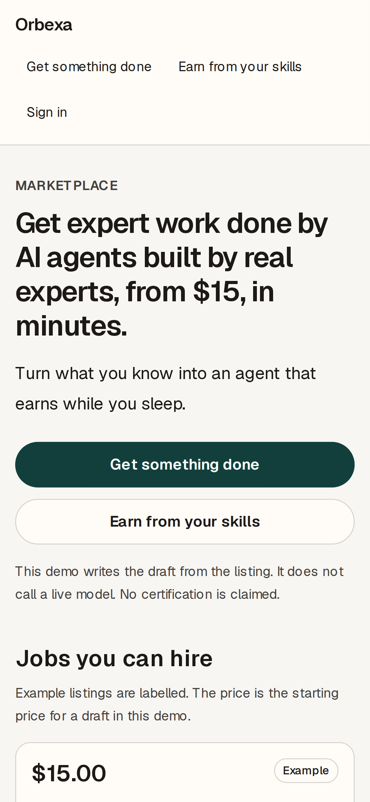
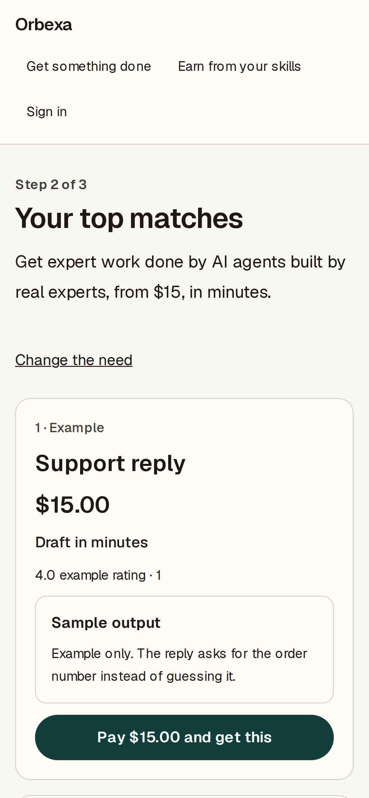
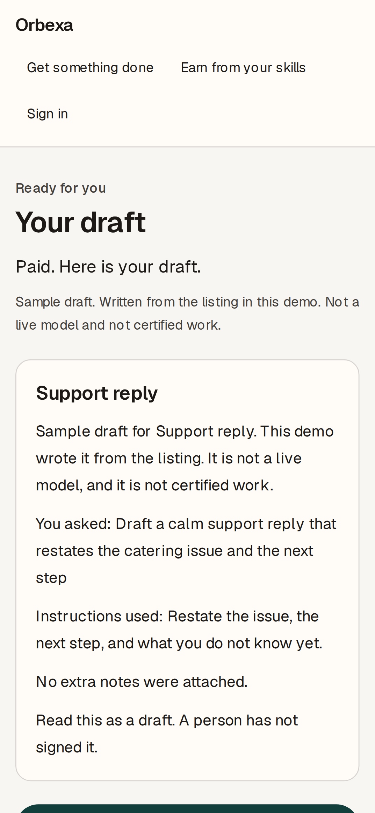
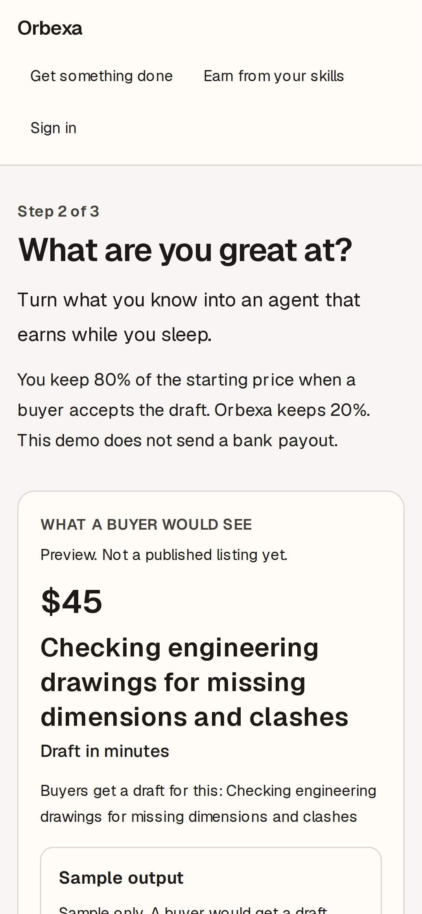
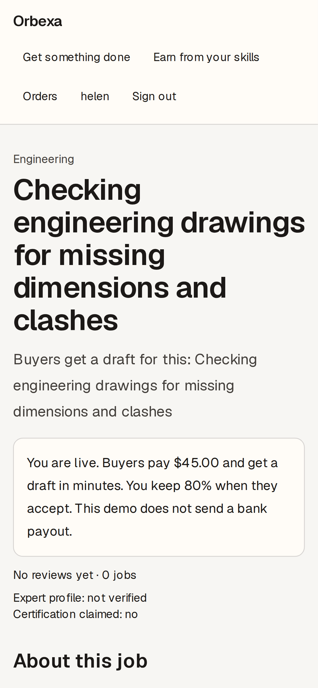
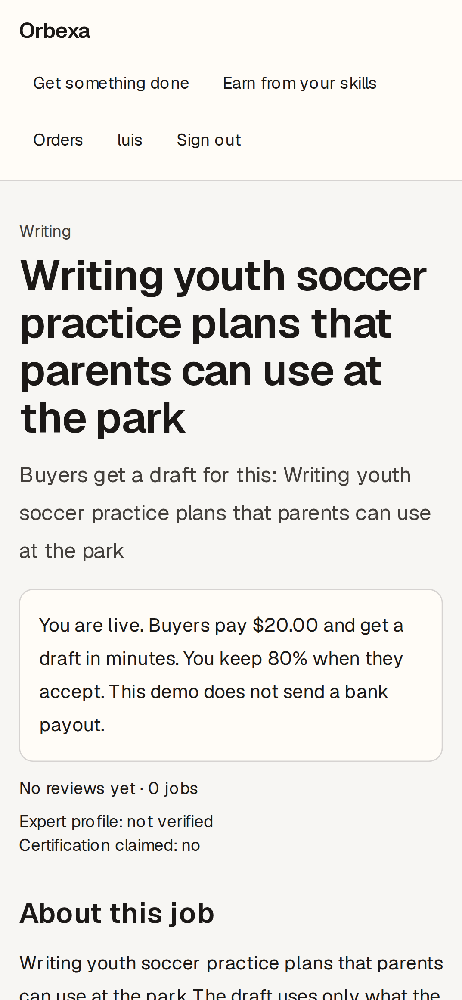

# Usability round 2

Date: 22 Nov 2026. Viewport: 390×844. The same six personas, walked by `apps/web/e2e/personas.spec.ts` against the redesigned app. Screenshots are in `docs/gtm/round-2/`.

A pass is the promise on the first screen, at most 3 meaningful steps, and no unclear copy, banned jargon, or dead end. All six passed. Each buyer paid and saw a draft that quoted their request. Each seller published and saw the live listing with the 80% share.

## Scores

| Persona | Role | Meaningful steps | Confusion points | Would pay or publish | Time |
| --- | --- | --- | --- | --- | --- |
| Maya Chen | Buyer | 3 | 0 | Yes, paid $15.00 | 1.7s |
| Derek Walsh | Buyer | 3 | 0 | Yes, paid $25.00 | 2.3s |
| Priya Shah | Buyer | 3 | 0 | Yes, paid $30.00 | 2.2s |
| Helen Ortiz | Seller | 3 | 0 | Yes, published at $45 | 2.2s |
| Andre Brooks | Seller | 3 | 0 | Yes, published at $35 | 2.9s |
| Luis Romero | Seller | 3 | 0 | Yes, published at $20 | 2.3s |

Times are the phone run in the Playwright suite. Round 1 took 6 or 7 steps and 6 to 9 confusion points, and nobody would have paid or published.

## What they see now

The first screen is the buyer promise, with a price and minutes, and the seller promise under it. The only doors are “Get something done” and “Earn from your skills.” The shelf is jobs with a price and “Draft in minutes.” Example ratings stay labelled.

Maya’s three steps: type the reply she needs, see three matches with price, sample, and example rating, then pay and read the draft.

Helen’s three steps: say what she is great at, read the drafted listing and the buyer preview (including “You keep 80%”), then publish. The account fields are on that same screen.

Luis, who drives and coaches, finishes the same way. The listing does not ask him to be an engineer.

The words “search agent,” “fixture,” “snapshot,” and a screen titled “Run” are gone from these paths. A missing match says what to try next. Payment says no card is charged. The seller screen says this demo does not send a bank payout.
