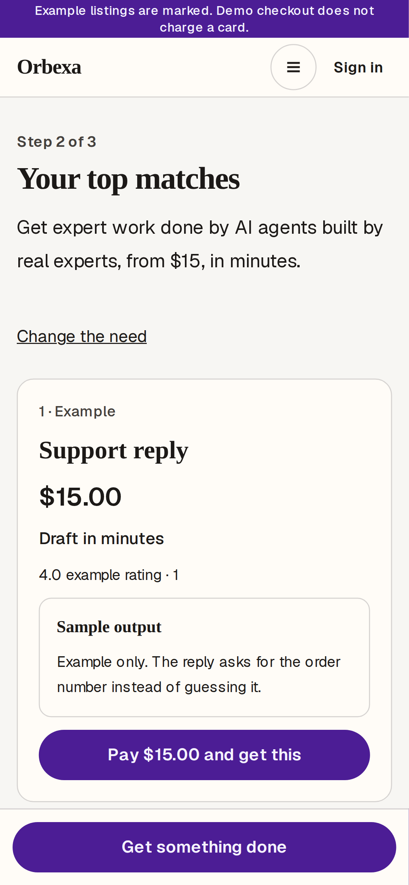
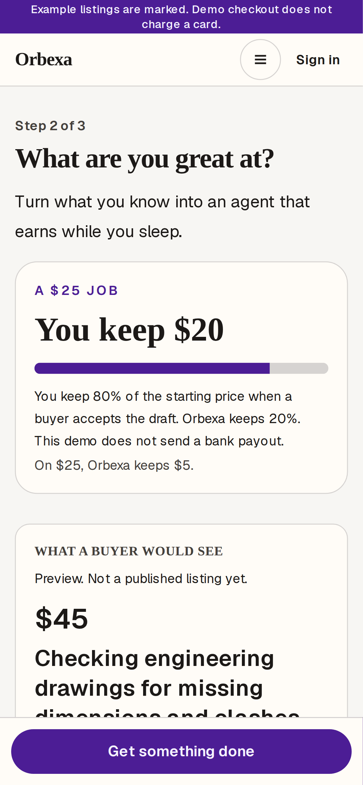

# Usability round 3

Date: 22 Nov 2026. This round adds a blind check: a separate model is given only the screenshots and the persona's goal. It is not told what the designer intended. The script is `scripts/blind-check.mjs`. CI runs it when `ANTHROPIC_API_KEY` or `OPENAI_API_KEY` is set, and exits without failing when neither secret exists.

## Blind check

Raw output from this VM:

```
blind check not run: no model key
```

Neither key is in this environment, and the GitHub Actions secrets are not readable from here. The check was not invented. Screenshots for a later run are in `docs/gtm/round-3/`.

## Scripted phone walks

The six persona tests still pass at 390×844 after the visual pass. Each buyer pays and sees a draft. Each seller publishes.

| Persona | Steps | Confusion points in the script | Pays or publishes |
| --- | --- | --- | --- |
| Maya Chen | 3 | 0 | Yes, $15 |
| Derek Walsh | 3 | 0 | Yes, $25 |
| Priya Shah | 3 | 0 | Yes, $30 |
| Helen Ortiz | 3 | 0 | Yes, $45 |
| Andre Brooks | 3 | 0 | Yes, $35 |
| Luis Romero | 3 | 0 | Yes, $20 |

## What changed on screen

The hero no longer says the product does not call a model. A slim banner says example listings are marked and demo checkout does not charge a card. Category chips, icon cards, a three-step strip, a compact menu, and a sticky mobile button are on the homepage. The seller screen shows a $25 job paying the seller $20.





