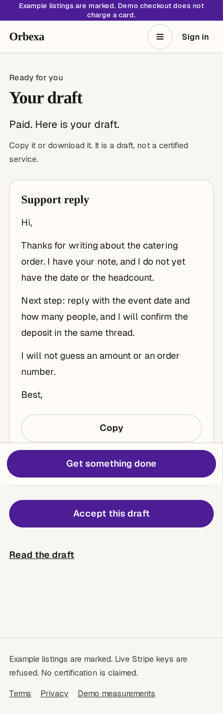
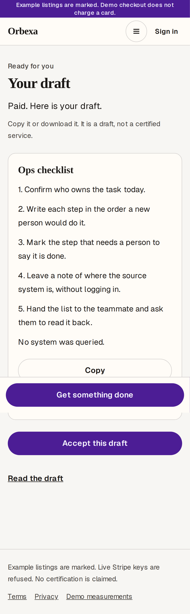
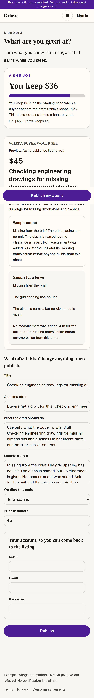
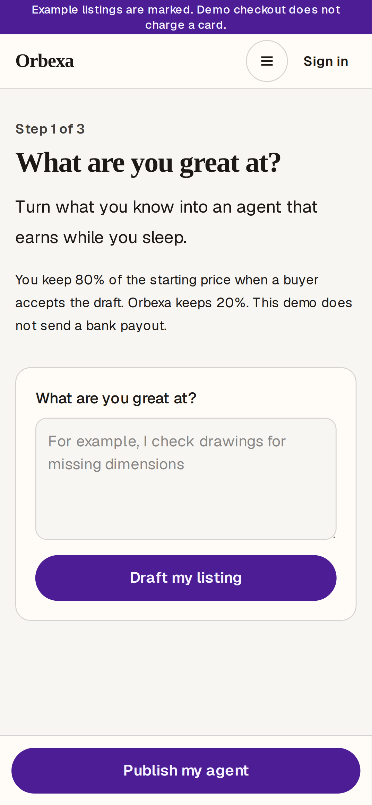

# Usability round 4

Date: 22 Nov 2026. This round answers the blind check that was run outside this VM on commit `17f510e`. That run used the retired model `claude-3-5-haiku-20241022`, which returned 404. The buyers said no because the sample and the paid draft repeated the instructions or showed a one-line placeholder. The sellers said yes and flagged the sticky “Get something done” button and an earnings card that used $25 on a $45 listing.

This VM still has no model key, so the blind check was not re-run and no answers were invented. `scripts/blind-check.mjs` now reads `docs/gtm/round-4/` and calls `ORBEXA_MODEL` (default `claude-sonnet-5-5`), then OpenAI `gpt-4o-mini` if Anthropic is unset.

## What changed on screen

- Example listings carry a full sample: a sendable reply, a checklist, a scope note, a drawing note, or a practice plan. The no-key draft is that same note. It does not print the instructions.
- A model error shows “Try again” and “Refund this payment”. The provider message and the instructions are not shown.
- On `/earn` and `/sell` the sticky button says “Publish my agent”. Buyer pages still say “Get something done”.
- The earnings card uses the drafted price. A $45 listing keeps $36. A $35 listing keeps $28. A $20 listing keeps $16.

## Scripted phone walks

The six persona tests pass at 390×844. The buyer result is the example fixture, labelled as such in the test, so the screenshot matches the shape of a live deliverable.

| Persona | Steps | Pays or publishes | What the screen shows |
| --- | --- | --- | --- |
| Maya Chen | 3 | Yes, $15 | A sendable catering reply |
| Derek Walsh | 3 | Yes, $25 | A five-step checklist |
| Priya Shah | 3 | Yes, $30 | Scope, assumptions, and out of scope |
| Helen Ortiz | 3 | Yes, $45 | Drawing note, and she keeps $36 |
| Andre Brooks | 3 | Yes, $35 | Receipt checklist, and he keeps $28 |
| Luis Romero | 3 | Yes, $20 | One-hour practice plan, and he keeps $16 |

